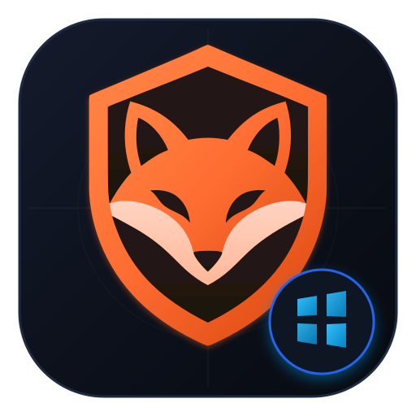

<div align="center">



# 🦊🪟 FoxyVPN Windows (v1.0.4)

**Native, Open-Source & Unlimited Multi-Account Desktop VPN for Windows 10 & 11**  
**کلاینت دسکتاپ بومی، پرتابل، متن‌باز و چنداکانته فایرفاکس VPN برای ویندوز ۱۰ و ۱۱**

[](https://github.com/mostafa5804/foxyvpn_windows/releases)
[-0078D6?style=for-the-badge&logo=windows&logoColor=white)](#)
[](#)
[-FE6C31?style=for-the-badge&logo=firefox-browser&logoColor=white)](#)
[](#)
[](LICENSE)

<br />

[English Documentation](#-english-documentation) • [راهنمای فارسی](#-راهنمای-فارسی) • [Releases / دانلود نسخه جدید](https://github.com/mostafa5804/foxyvpn_windows/releases)

---

</div>

<br />

# 🇬🇧 English Documentation

## 🌟 Overview
**FoxyVPN Windows** is a high-performance, lightweight, open-source Windows desktop VPN client. It allows you to tunnel your entire operating system or browser traffic through **Mozilla Guardian's free 50 GB monthly allowance** over Fastly's globally distributed HTTP/2 CONNECT (MASQUE) edge topology.

### What's New in v1.0.4:
- **No-Scroll Single Viewport UI:** Sleek, compact Windows Fluent Bento layout designed to fit entirely on screen without window scrollbars.
- **Copy Logs Button:** One-click clipboard copy with status confirmation in the diagnostic control-plane console.
- **Automatic Smart Server Selection:** Default auto-connects to the node with the lowest live ping and best connectivity.
- **Real Ping Latency Measurement:** Real-time TCP handshake socket timing across all Fastly edge regions with a live refresh button.
- **Persistent Session Storage:** Full login, settings, and multi-account pool persistence across app restarts (Portable & Setup).
- **Clean Initial State:** Zero hardcoded demo accounts; secure user-authenticated session management.
- **Bilingual Interface:** Instant FA/EN toggle with Vazirmatn Persian typography (RTL) and default Light theme.

---

## ⚡ Multi-Account Token Pool (Unlimited Capacity)

### ❓ How many accounts can you add?
**Unlimited!** There is no hard limit on the number of accounts you can pool:
- **1 Account:** 50 GB / month
- **2 Accounts:** 100 GB / month
- **3 Accounts:** 150 GB / month
- **5 Accounts:** 250 GB / month
- **10 Accounts:** 500 GB / month

### 🛠️ How to Add Accounts (3 Flexible Methods):
1. **Easy & Automatic (Email & Password):**  
   You do **not** need to hunt for session tokens! Simply enter the email and password of your secondary or tertiary Firefox accounts. The app automatically derives PBKDF2-SHA256 (1000 rounds) + HKDF keys, logs in with Mozilla FxA, stores the session key, and combines the quotas.
2. **Manual Verification Mode (Token / Browser URL):**  
   If you click an activation link in an external browser (Firefox, Chrome, mobile), you bypass redirect failures. Simply copy and paste the session token, JWT (`ey...`), 6-digit code, or the full browser address bar into the app.
3. **Raw Token Import (Advanced):**  
   Batch paste 32- or 64-character hexadecimal session tokens (one per line) to instantly activate multiple accounts.

---

## 🚀 Key Features

| Feature | Description |
| :--- | :--- |
| **In-App Registration & Sign-In** | Create new accounts or log into existing Firefox accounts directly inside the app without browser redirect hassles. |
| **Dual Network Engines** | **1. Full System Wintun TUN:** Creates Layer-3 `FoxyVPN-Adapter` (`10.0.0.2/24`) routing all Windows traffic (`0.0.0.0/0`).<br>**2. WinINET System Proxy:** Runs a local SOCKS5 (`127.0.0.1:1080`) proxy and configures Windows Registry. |
| **Anti-DPI TLS SNI Split** | Fragments initial `TLS ClientHello` packets at the SNI boundary with `TCP_NODELAY` to bypass Deep Packet Inspection (DPI) censorship. |
| **Secure Encrypted DNS (DoH)** | Intercepts UDP/53 DNS queries and routes them through encrypted Cloudflare (`1.1.1.1`), Quad9 (`9.9.9.9`), or Google (`8.8.8.8`) servers. |
| **Kill Switch Protection** | Automatically cuts internet traffic if the tunnel drops unexpectedly to prevent real IP leaks. |
| **Diagnostics & Copy Logs** | Control-plane live terminal with one-click copy, clear, and refresh actions. |

---

## 🤝 Collaboration with the Android Developer
This Windows client was inspired by and ported from the popular Android project **[Vauth/FoxyVPN](https://github.com/vauth/foxyvpn)** and reference Go implementations.


---

## 📦 Download & Releases

Download the latest pre-compiled binaries from **[GitHub Releases](https://github.com/mostafa5804/foxyvpn_windows/releases)**:
- 📦 **`FoxyVPN-Portable.exe` (Recommended):** Standalone single executable with embedded `wintun.dll`. Zero installation required.
- 💿 **`FoxyVPN-Setup.exe`:** Standard NSIS Windows Installer with desktop & Start Menu shortcuts.
- 🗜️ **`FoxyVPN-Windows-amd64.zip`:** Portable archive containing binary and documentation.

---

<br />

# 🇮🇷 راهنمای فارسی

## 🌟 معرفی پروژه
**FoxyVPN Windows** یک کلاینت دسکتاپ بومی، سریع، پرتابل و متن‌باز برای ویندوز ۱۰ و ۱۱ است که به شما امکان می‌دهد از **سهمیه ۵۰ گیگابایت ماهانه رایگان موزیلا** (ارائه‌شده روی سرورهای Fastly با پروتکل HTTP/2 CONNECT و کارت شبکه مجازی Wintun) در **کل سیستم‌عامل ویندوز** استفاده کنید.

### امکانات جدید در نسخه ۱.۰.۴ (v1.0.4):
- **طراحی بدون نیاز به اسکرول (Single Viewport):** چیدمان فشرده، زیبا و بهینه‌شده به سبک Windows Fluent Bento که کل پنجره داشبورد را بدون نوار اسکرول صفحه‌ای نمایش می‌دهد.
- **دکمه کپی لاگ‌ها:** کپی سریع و تک‌کلیکه کل لاگ‌های تشخیصی به حافظه کلیپ‌بورد همراه با نشان تایید «✓ کپی شد!».
- **انتخاب سرور اتوماتیک (پیش‌فرض):** اتصال خودکار و هوشمند به نزدیک‌ترین سرور دارای کمترین پینگ زنده و بالاترین پایداری.
- **سنجش پینگ واقعی سرورها:** اندازه‌گیری دقیق زمان رفت و برگشت سوکت TCP با سرورهای Fastly و دکمه «تست مجدد پینگ‌ها».
- **ماندگاری کامل اطلاعات در حافظه (Persistence):** ذخیره همیشگی وضعیت لاگین، سهمیه و استخر اکانت‌ها در نسخه پرتابل و نصبی.
- **حذف کامل اکانت‌های دمو:** وضعیت اولیه کاملاً پاک و استاندارد جهت ورود هر کاربر با اکانت اختصاصی خود.
- **دو زبانه کامل فارسی و انگلیسی:** سوییچ لحظه‌ای بین فارسی (با فونت وزیرمتن و راست‌به‌چپ) و انگلیسی، با تم پیش‌فرض روشن (Light) و دکمه تم تاریک.

---

## ⚡ استخر چند اکانته (افزایش نامحدود سهمیه)

### ❓ چند تا اکانت می‌توان اضافه کرد؟
**کاملاً نامحدود!** هیچ محدودیتی در تعداد اکانت‌های متصل وجود ندارد:
- **۱ اکانت:** ۵۰ گیگابایت در ماه
- **۲ اکانت:** ۱۰۰ گیگابایت در ماه
- **۳ اکانت:** ۱۵۰ گیگابایت در ماه
- **۵ اکانت:** ۲۵۰ گیگابایت در ماه
- **۱۰ اکانت:** ۵۰۰ گیگابایت در ماه

### 🛠️ نحوه افزودن اکانت‌ها (۳ روش مختلف):
1. **روش آسان و خودکار (ایمیل و رمز عبور):**  
   نیازی به گشتن دنبال توکن ندارید! کافیست ایمیل و رمز اکانت‌های دوم، سوم یا بیشتر خود را وارد کنید. برنامه به صورت خودکار کلیدهای امنیتی نشست (PBKDF2-SHA256 + HKDF) را تولید، احراز هویت کرده و ۵۰ گیگابایت سهمیه به استخر شما اضافه می‌کند.
2. **حالت تایید دستی (Manual Verification با توکن یا لینک):**  
   اگر لینک فعال‌سازی ایمیل را در مرورگر سیستم یا گوشی باز کردید، برای دور زدن مشکلات ریدایرکت خودکار، کافیست توکن احراز هویت، JWT یا آدرس نوار مرورگر را در تب تایید دستی Paste کنید.
3. **ورود مستقیم توکن‌های خام (Raw Tokens):**  
   امکان وارد کردن دسته‌ای توکن‌های هگزادسیمال ۳۲ یا ۶۴ کاراکتری نشست فایرفاکس (هر خط یک توکن).

---

## 🚀 مشخصات فنی و قابلیت‌ها

| عنوان | توضیح فنی |
| :--- | :--- |
| **کارت شبکه Wintun لایه ۳** | ایجاد کارت شبکه مجازی `FoxyVPN-Adapter` با آی‌پی `10.0.0.2/24` و هدایت امن و پرسرعت کل ترافیک ویندوز (`0.0.0.0/0`). |
| **پراکسی محلی WinINET** | راه‌اندازی پراکسی محلی `SOCKS5 (127.0.0.1:1080)` و اعمال خودکار در رجیستری ویندوز برای سازگاری کامل نرم‌افزارها. |
| **تکنولوژی ضد فیلترینگ TLS SNI Split** | شکستن پکت‌های اولیه ClientHello در نقطه حساس SNI همراه با فلگ `TCP_NODELAY` جهت دور زدن بازرسی عمیق بسته‌ها (DPI). |
| **DNS امن بر بستر DoH** | ارسال تمام کوئری‌های DNS از داخل تونل رمزنگاری‌شده به سرورهای کلودفلر (`1.1.1.1`)، کواد۹ (`9.9.9.9`) و گوگل (`8.8.8.8`). |
| **کیل سوییچ (Kill Switch)** | قطع فوری اینترنت در صورت قطعی موقت تونل برای حفظ امنیت و عدم لو رفتن آی‌پی واقعی. |

---

## 🤝 همگام‌سازی و اطلاع به سازنده نسخه اندروید
این پروژه ویندوزی بر پایه معماری ارزشمند نسخه اندروید **[Vauth/FoxyVPN](https://github.com/vauth/foxyvpn)** و کلاینت مرجع Go توسعه یافته است.

---

## 📥 دانلود نسخه‌های آماده (Releases)

از بخش **[GitHub Releases](https://github.com/mostafa5804/foxyvpn_windows/releases)** می‌توانید خروجی‌های آماده را دریافت کنید:
- 📦 **`FoxyVPN-Portable.exe` (پیشنهادی):** نسخه تک‌فایل بدون نیاز به نصب، درایور Wintun در دل فایل تعبیه شده و بلافاصله اجرا می‌شود.
- 💿 **`FoxyVPN-Setup.exe`:** فایل نصبی رسمی با شورتکات دسکتاپ و قابلیت حذف از کنترل‌پنل ویندوز.
- 🗜️ **`FoxyVPN-Windows-amd64.zip`:** نسخه فشرده حاوی فایل اجرایی و راهنما.

---

## 🛠️ دستورات کامپایل محلی (Local Build)

```powershell
# ۱. نصب کتابخانه‌های فرانت‌اند
npm install

# ۲. کامپایل باینری بومی ویندوز ۶۴ بیتی با Wails
wails build -platform windows/amd64 -clean -o FoxyVPN.exe
```

---

## 📄 مجوز انتشار (License)
این پروژه تحت مجوز متن‌باز **MIT License** منتشر شده است. استفاده، بهینه‌سازی و بازنشر آن کاملاً آزاد است.
